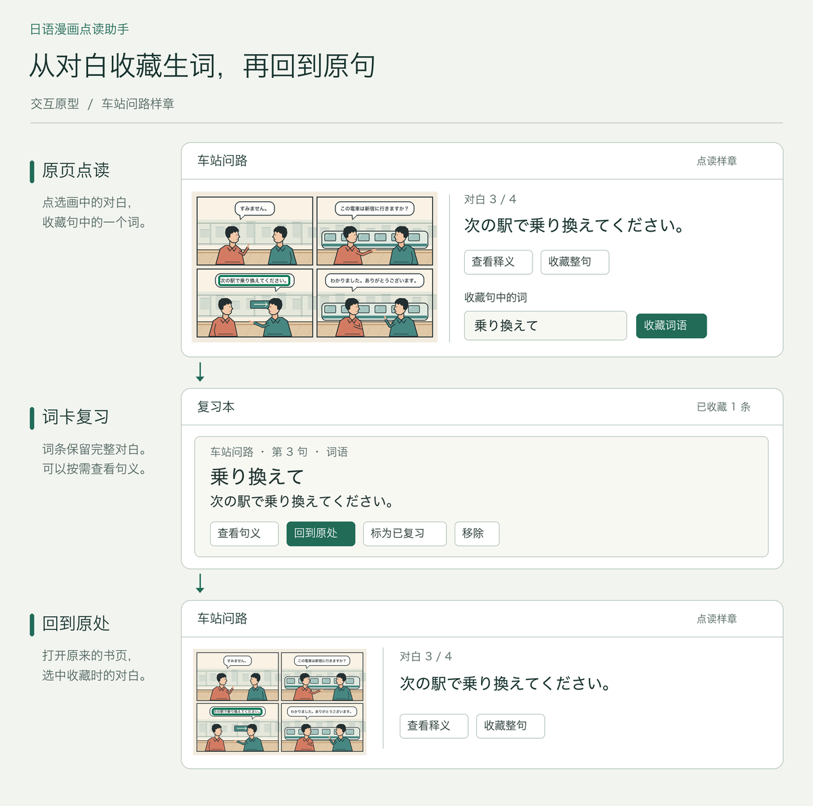

# 日语漫画点读助手 · 产品与验收说明

读者在漫画里记住了「乗り換えて」（换乘），几天后却忘了当时说的是在哪一站换乘。**首版的验收任务是让读者在复习本点一次「回到原处」，看到收藏这个词时的原页和原句。**

## 从阅读习惯确定首版范围

面向有基础、愿意用日语原版漫画积累表达的读者。截图能保留画面，回顾时要翻找。单独抄词方便查阅，却容易丢掉说话人和上下文。这是本项目选择的使用场景，真实读者的复习效果还有待验证。

| 使用时刻 | 读者想完成的事 | 产品决定 |
| --- | --- | --- |
| 初读 | 在原图上看清某句对白，按需查看释义 | 以对白的位置作为点击区域，默认显示日文。内置样章提供预写释义，自带漫画支持填写自己的释义。 |
| 记词 | 收藏一个词，保留它在句中的用法 | 可收藏整句，或从当前对白中输入、粘贴要记的词。词卡同时关联原句、书页和对白位置。 |
| 复习 | 确认是谁在什么场景说了这句话 | 同一卷不同页的收藏汇入复习本。「回到原处」恢复阅读页并选中对应对白。 |

## 交互原型

想在内置样章重走这条路径，打开「车站问路」，点左下格的对白，展开「收藏句中的词」，输入或粘贴「乗り換えて」后点「收藏词语」。切到「复习本」，找到这张卡并点「回到原处」。

## 从漫画文件到点读区域

1. **导入时识别。** Mac 上的 Swift 工具将多页扫描 PDF 按页转图，也可处理单张 JPG 或 PNG。Apple Vision 在本机读取横排日语对白，返回文字和位置。因书页内容固定，识别一次即可供多次阅读和复习使用。
2. **用标注把工具和网页接起来。** 每卷的 JSON 标注（扩展名 `.mokuro`）记录图片文件名、原图尺寸和每条对白的文字框。选择标注和配套原图后，网页先核对文件名及尺寸，再按书页顺序打开。已有兼容标注的读者可以直接从这一步开始。
3. **在浏览器里阅读和复习。** HTML / JavaScript 阅读器把文字框换算成页面上的相对位置，图片缩放后仍能点选对白。收藏、校正、释义和复习状态保存在当前浏览器。下次重开自带漫画时，重新选择同一份标注和对应原图即可读取此前的记录。

## 评测如何影响选型

整句被漏掉时，读者也会失去它的点读和收藏入口。因此用同一组 **6 页横排测试漫画**比较两种处理方式。每页一个生活场景、4 句预先写好的日文对白，共 24 句。图文内容和识别工具相同，改变送入识别器的图片宽度。每句最多计一次，文字和标点全部相同才计为匹配。

| 送入识别器的图片 | 整句完全匹配 | 逐句核对 |
| --- | ---: | --- |
| 400 像素宽的缩略图 | 22 / 24 | 漏掉 1 句，另有 1 句错 1 字 |
| 1600 像素宽的原图 | 24 / 24 | 本组对白均匹配 |

据此选择在原图上识别，再按阅读器尺寸显示。两组样本是同一版式的自制页面。这次对照能回答首版用哪种输入尺寸，复杂竖排、手写和密集分镜的表现仍待验证。

## 验收清单

| 情形 | 可复现的操作 | 通过条件 |
| --- | --- | --- |
| 点读和回看 | 在内置样章第 3 句收藏「乗り換えて」，从复习卡点「回到原处」 | 画面显示「车站问路」，当前对白为「次の駅で乗り換えてください。」 |
| 跨页收藏 | 在同一卷的两页各收藏一句，再分别从复习本回看 | 每张卡都返回对应书页和对应对白。 |
| 打乱导入顺序 | 同时导入样卷标注和倒序选中的多张原图 | 阅读器按标注中的书页顺序翻页。 |
| 页面没有对白 | 打开样卷中的空白页 | 可继续浏览原图、正常翻页，并看到本页无可点读对白的提示。 |
| 原图选错 | 选择与标注文件名或尺寸不符的图片后尝试打开 | 指出不匹配的文件或原因，保留当前阅读页。 |
| 修正识别 | 在某句的「校正识别文字」中修改一个字并保存，再点「恢复原始识别」 | 可以在订正文本和原始识别结果之间恢复。 |
| 重开后继续复习 | 在允许本地存储的同一浏览器先收藏，再刷新，并重新选择同一份标注和原图 | 可以再次看到已保存的词卡和订正。 |

当前交付物是可以本地使用的阅读器及转换工具。重新生成标注可能产生新的书卷标识，建议保留已有标注及配套原图。不同浏览器各自保存笔记，清除浏览器数据会同时清除其中的学习记录。
